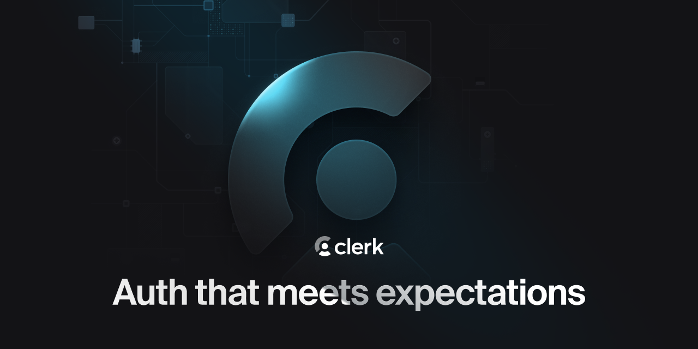

<p align="center">
  <a href="https://clerk.com?utm_source=github&utm_medium=clerk_docs" target="_blank" rel="noopener noreferrer">
    <picture>
      <source media="(prefers-color-scheme: dark)" srcset="./public/light-logo.png">
      
    </picture>
  </a>
  <br />
</p>
<div align="center">
  <h1>
    Clerk, Next.js App Router, tRPC, Prisma Demo
  </h1>
  <a href="https://www.npmjs.com/package/@clerk/clerk-js">
    
  </a>
  <a href="https://clerk.com/discord">
    
  </a>
  <a href="https://x.com/clerk">
    
  </a>
  <br />
  <br />
  
</div>

## Introduction

Clerk is a developer-first authentication and user management solution. It provides pre-built React components and hooks for sign-in, sign-up, user profile, and organization management. Clerk is designed to be easy to use and customize, and can be dropped into any React or Next.js application.

This repository demonstrates how to use Clerk to create a tRPC context that uses Clerk's authentication context, so that you can use Clerk's authentication state in your tRPC procedures. For more information, see the [guide in the Clerk Docs](https://clerk.com/docs/guides/development/trpc).

## Deploy

Deploy the template to Vercel with the button below. You'll need to set your Clerk API keys and a PostgreSQL connection string in the Vercel dashboard.

[](https://vercel.com/new/clone?repository-url=https%3A%2F%2Fgithub.com%2Fclerk%2Fclerk-nextjs-trpc-prisma&env=NEXT_PUBLIC_CLERK_PUBLISHABLE_KEY,CLERK_SECRET_KEY,DATABASE_URL&envDescription=Clerk%20API%20keys%20and%20a%20PostgreSQL%20connection%20string&envLink=https%3A%2F%2Fclerk.com%2Fdocs%2Fguides%2Fdevelopment%2Ftrpc&redirect-url=https%3A%2F%2Fclerk.com%2Fdocs%2Fguides%2Fdevelopment%2Ftrpc)

The deployment does not create database tables. Before using the deployed app, use a local checkout with dependencies installed and set `DATABASE_URL` to the same PostgreSQL database you configured in Vercel. Apply the included migrations with:

```bash
pnpm prisma migrate deploy
```

## Running the template

```bash
git clone https://github.com/clerk/clerk-nextjs-trpc-prisma
```

To run the example locally, you need to:

1. `pnpm install` the required dependencies.
1. In the project's root folder, copy `.env.example` to `.env`. Add your Clerk API keys from the [**API keys**](https://dashboard.clerk.com/~/api-keys) page in the Clerk Dashboard, and set `DATABASE_URL` to your PostgreSQL connection string.
1. `pnpm prisma migrate deploy` to create the database tables.
1. `pnpm dev` to launch the development server.
1. Select the "Sign in" button in the top-right corner of the app's homepage.

## Learn more

To learn more about Clerk and Next.js, check out the following resources:

- [Quickstart: Get started with Next.js and Clerk](https://clerk.com/docs/nextjs/getting-started/quickstart?utm_source=DevRel&utm_medium=docs&utm_campaign=templates&utm_content=clerk-nextjs-trpc)

- [Clerk Documentation](https://clerk.com/docs?utm_source=DevRel&utm_medium=docs&utm_campaign=templates&utm_content=clerk-nextjs-trpc-prisma)
- [Next.js Documentation](https://nextjs.org/docs)

## Found an issue or want to leave feedback

[Contact](https://clerk.com/contact/support) or email [support@clerk.com](mailto:support@clerk.com) us for support.

## Connect with us

You can discuss ideas and meet others from the community in our [Discord](https://clerk.com/discord).

You can also follow [@clerk on X](https://x.com/clerk) for updates.
